<p align="center">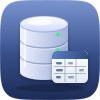</p>
<h1 align="center">Pocket Database</h1>
<p align="center">Every database on your server, in one calm place. Pocket Database finds the PostgreSQL, MySQL / MariaDB, Redis and SQLite databases your apps use — database containers with the credentials from their own settings, SQLite files in the folders your containers keep their data in — and lets you browse tables, filter and search rows, run SQL with AI that writes, explains and fixes queries, and change data safely: everything starts read-only, every change is one transaction and logged, and a SQLite file an app has open is only changed with that app paused and a copy kept. It watches them too, with a push when one goes down and a chart of how they grow.<br>One Go binary, one SQLite file, one volume. Part of the Pocket apps; works on its own too.</p>
<p align="center">
  <a href="https://github.com/abjelosevic88/pocket-homelab-database/actions"></a>
  <a href="https://github.com/abjelosevic88/pocket-homelab-database/pkgs/container/pocket-homelab-database"></a>
  <a href="LICENSE"></a>
</p>

---

<p align="center">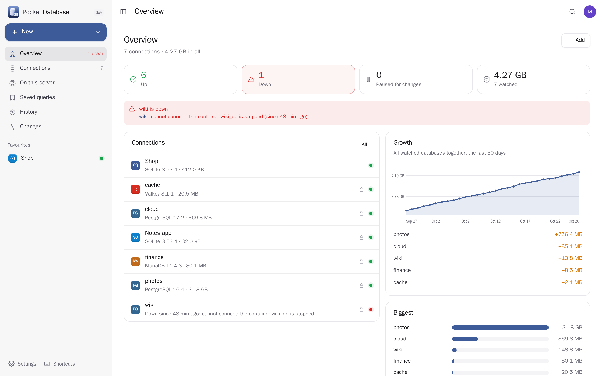</p>

<table>
  <tr>
    <td width="50%">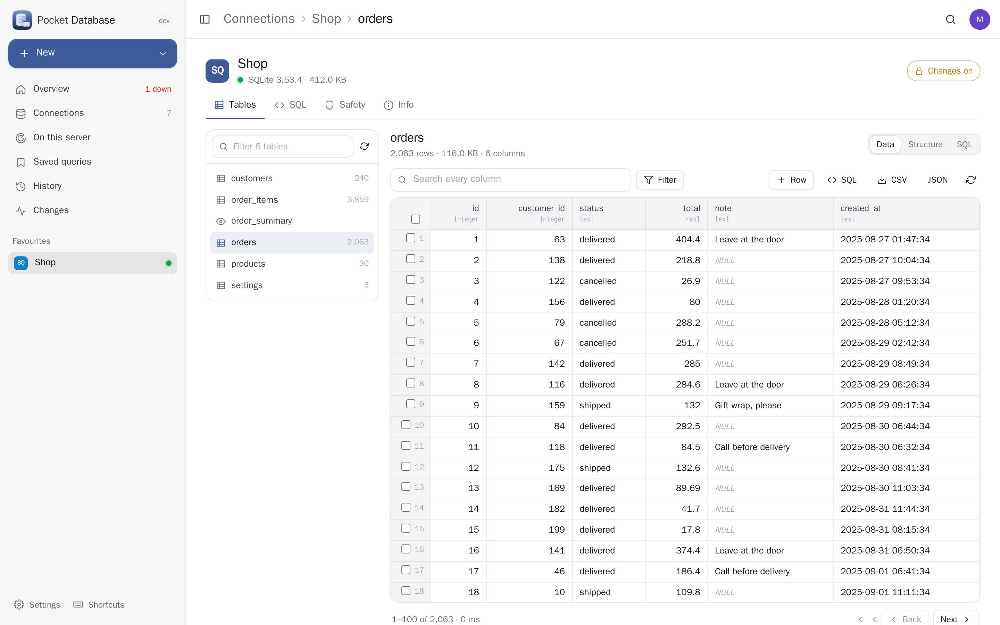</td>
    <td width="50%">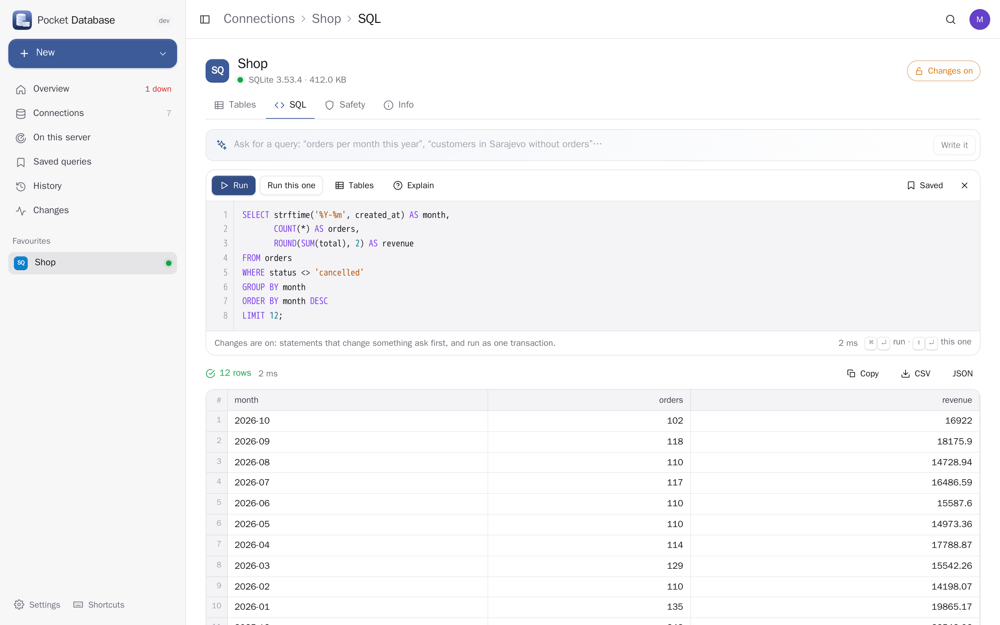</td>
  </tr>
  <tr>
    <td align="center"><sub>Tables: sort, filter, search every column, edit a cell or a whole row, add and delete, export CSV or JSON.</sub></td>
    <td align="center"><sub>SQL: highlighting, run the selection or the statement under the cursor, saved queries, history — or just ask.</sub></td>
  </tr>
  <tr>
    <td width="50%">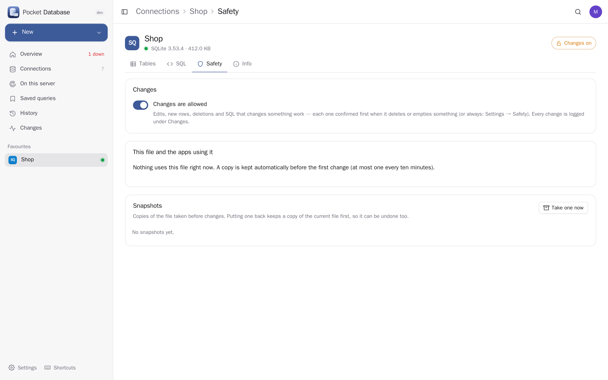</td>
    <td width="50%">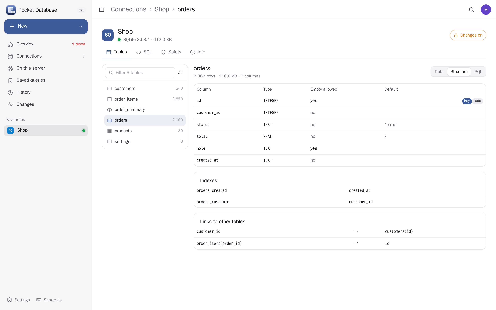</td>
  </tr>
  <tr>
    <td align="center"><sub>Safety: read-only until you say so; live SQLite files are changed with their app paused, with snapshots to put back.</sub></td>
    <td align="center"><sub>Structure: columns, keys, indexes, foreign keys both ways, and the CREATE statement.</sub></td>
  </tr>
  <tr>
    <td width="50%">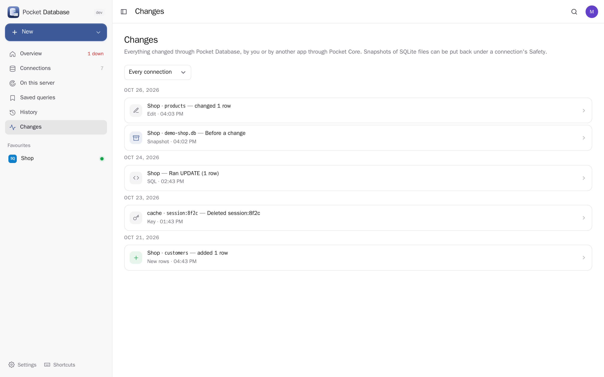</td>
    <td width="50%">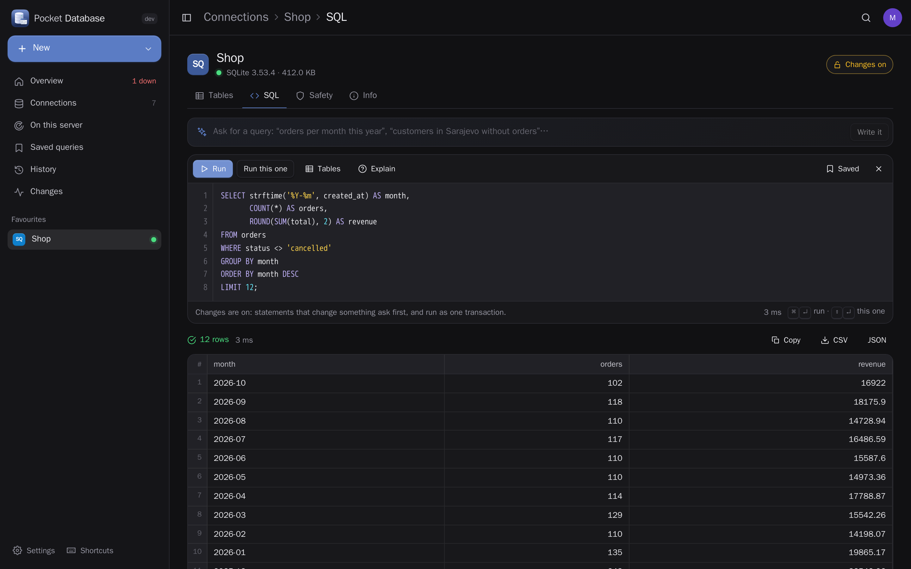</td>
  </tr>
  <tr>
    <td align="center"><sub>Changes: who changed what, when, with the statement and the copy that was kept.</sub></td>
    <td align="center"><sub>Light and dark, following your system.</sub></td>
  </tr>
</table>

<p align="center">
  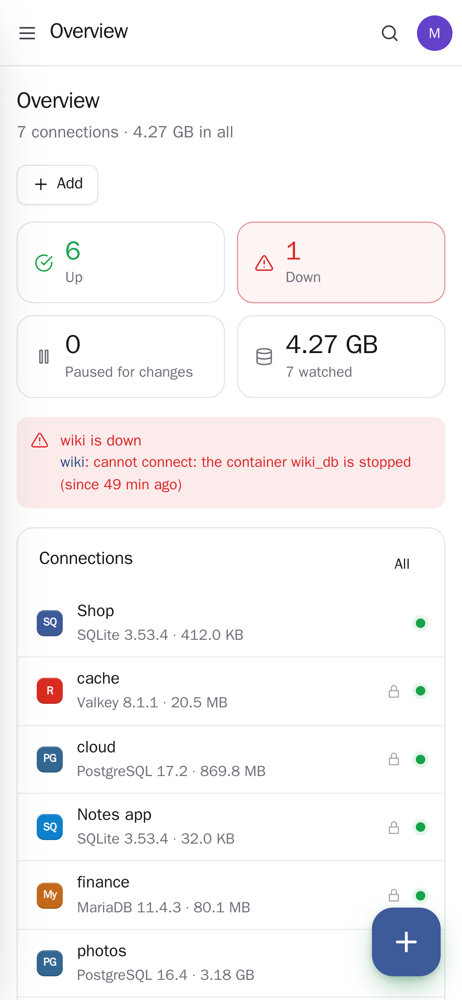&nbsp;&nbsp;
  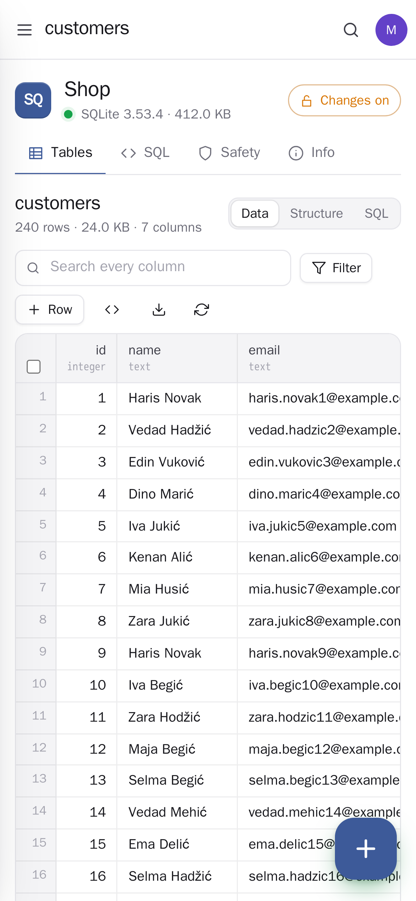&nbsp;&nbsp;
  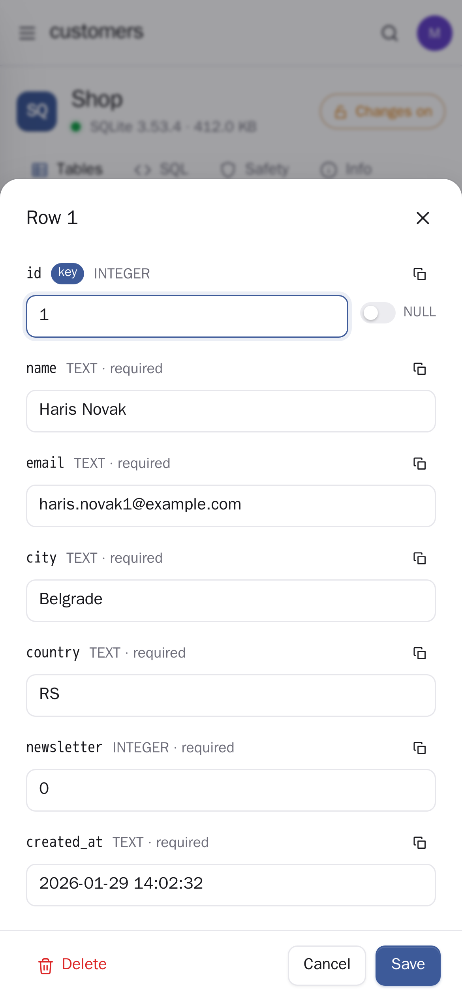&nbsp;&nbsp;
  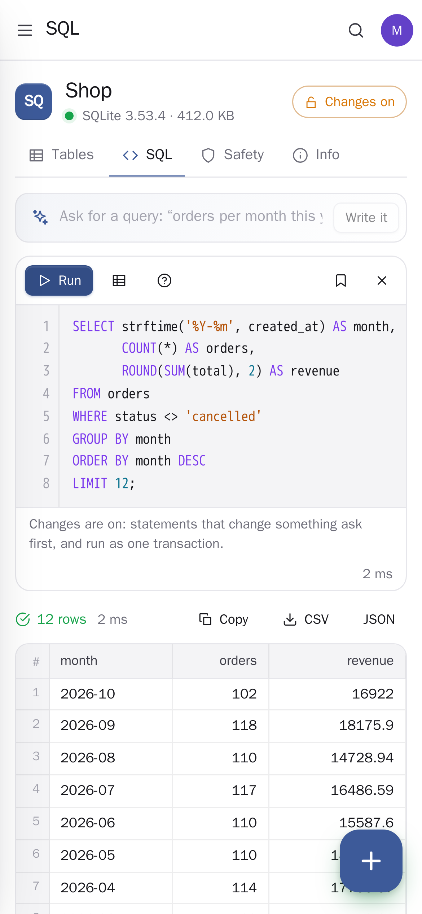
</p>

- **Finds what you run**: *On this server* lists every PostgreSQL, MySQL / MariaDB and Redis container with the user, password and database from its environment, and every SQLite file in the folders containers mount (backup copies hidden). Add them all in one go; connections to containers follow a recreated container.
- **Four engines, one way of working**: PostgreSQL (TimescaleDB, PostGIS, Immich's vector Postgres…), MySQL and MariaDB, SQLite, Redis and Valkey — databases, schemas, tables and views in a tree; rows, structure and DDL for each table; a key browser and a console for Redis.
- **Safe by default**: new connections are read-only. With changes on, each statement that deletes or empties something asks first, everything run together is one transaction, and every change lands in the change log. A SQLite file a running container uses is changed only while that container is paused — Pocket Database stops it, takes a snapshot, and starts it again when you press Done or when the pause time is up.
- **AI that helps, never acts**: describe what you want and get the query, ask what a query does, or fix one that failed — using your tables' names, never their rows. Pocket AI through Pocket Core, or your own OpenAI-compatible key.
- **Watching**: connections are checked every five minutes; a push when one goes down and when it is back, and a size chart per database and for all of them.
- **Everyone their own**: each person has their own connections, history, saved queries and settings; passwords are sealed with a key that never leaves the server. Only admins may open files and containers on the server.

## Run it

```sh
docker run -d --name pocket-database --network host --group-add $(getent group docker | cut -d: -f3) \
  -v ./data:/data -v /var/run/docker.sock:/var/run/docker.sock -v /srv:/srv \
  -e BASE_URL=https://database.example.com -e SECURE_COOKIES=true \
  ghcr.io/abjelosevic88/pocket-homelab-database:latest
```

or `docker compose up -d` with [docker-compose.yml](docker-compose.yml). Host networking reaches database containers on their own networks; the Docker socket finds them and pauses apps for safe changes; mount the folders your apps keep their data in at the same path (or set `SCAN_PATHS`). Without the socket it is a plain database client: add connections by hand or upload a SQLite file. Open it, create the first account and press *Find databases on this server*. All options: [docs/configuration.md](docs/configuration.md). API: [docs/api.md](docs/api.md).

## With Pocket Core

Set `CORE_URL` and `CORE_REGISTRATION_KEY` and Pocket Database joins the box: people sign in with Pocket Core, Pocket AI writes and explains queries, and other Pocket apps can see your databases for you through app links — `databases:read` (health, sizes, structure; never passwords, addresses or paths) and `databases:query` (read-only queries) — but never change anything. Events on the bus: `database.down`, `database.up`, `database.changed`, `database.restored`. Without Core everything works with local accounts and your own AI key; the Core-only choices stay visible, greyed out.

## Develop

```sh
make dev     # API on :8080 with demo data + Vite on :5173
make test    # go vet, go test, tsc
make         # web + binary
```

MIT licensed.
